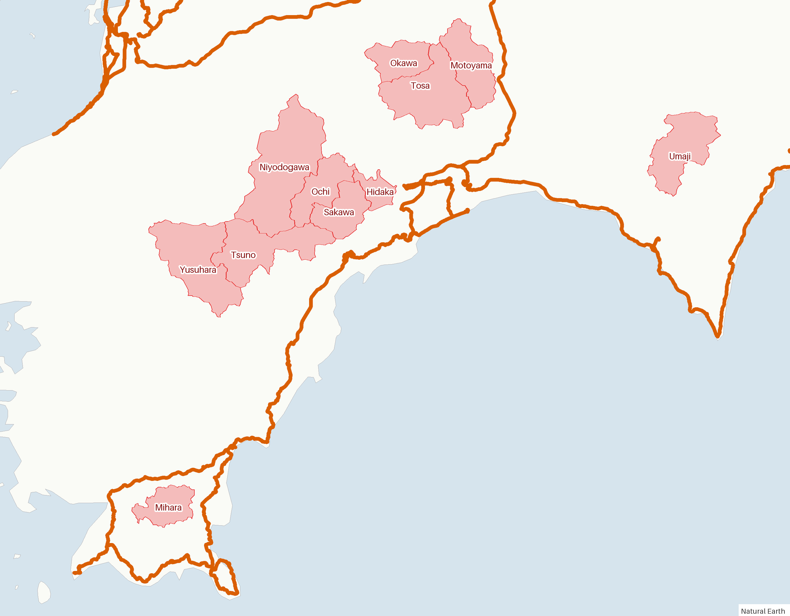
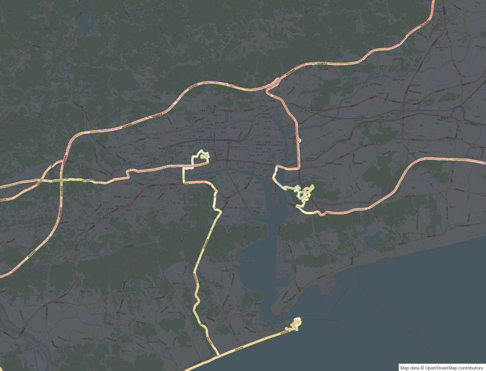
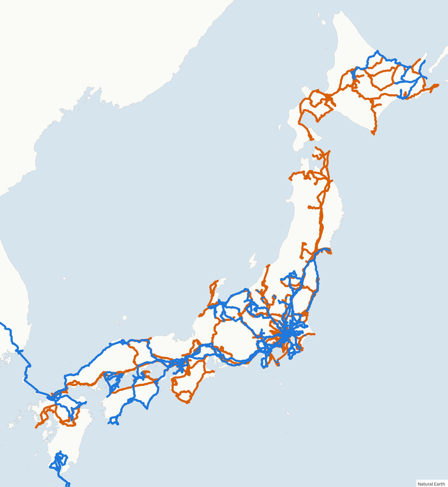
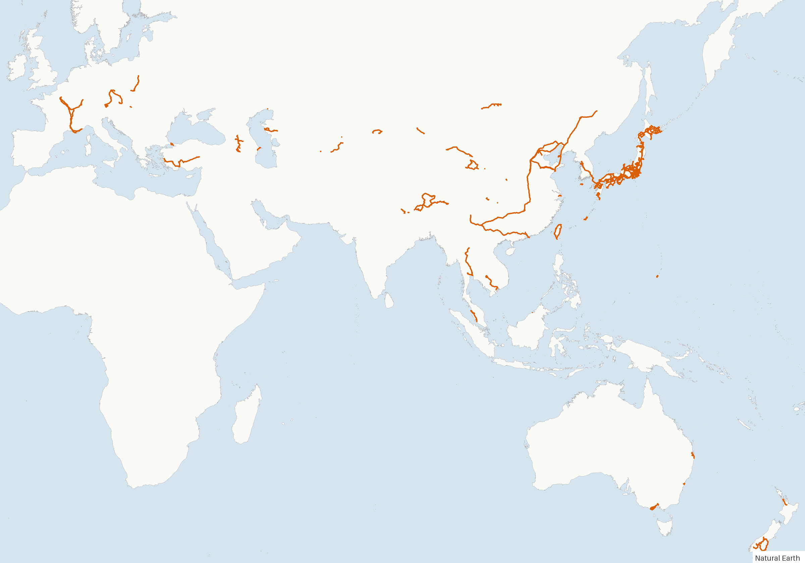

# fogprint

[](LICENSE) [](https://github.com/sponsors/b-z)

[中文](docs/zh/README.md) · [日本語](docs/ja/README.md)

**Ask an AI about your Fog of World map: where you have been, what is left, and how to get there.**

fogprint reads the data of [Fog of World](https://fogofworld.app) (the app that clears a fog wherever you go) and turns it into answers an AI agent such as Claude Code or Codex can work with. It comes as a command-line tool plus a skill that teaches the agent how to use it, so you can simply ask:

- "Which states of the US have I never set foot in? Plan a week that ticks off as many as possible."
- "Which JR lines in Kyushu have I not ridden yet? Make a 3-day rail-pass itinerary for the longest gaps."
- "Plan a two-day drive from Lyon that is mostly on roads I have never driven."
- "Which parts of my city have I never walked? Suggest a 10 km loop through them."
- "What did my trip to Kochi add to the map?" / "What changed between my January and August snapshots?"
- "How many municipalities of Japan have I visited, by prefecture?"
- "Draw my explored area over Scotland."

It works anywhere in the world: country and state boundaries come from Natural Earth, municipalities and districts of any country from geoBoundaries, and roads, railways and streets from OpenStreetMap.

> fogprint is an independent project and is not affiliated with Fog of World or its developer. It only reads your data and never writes to the app's folder.

## Examples

Real conversations in Claude Code, run on one real Fog of World account. The commands are what Claude ran; you only type the question.

### "Which prefectures of Japan have I never been to? Plan a weekend for the last one."

> **Claude** · ran `fogprint regions --level admin1 --country JPN --unvisited-only --src all`
>
> You have been to **46 of the 47 prefectures**. Only **Fukui** is left, and you have never even come close: the nearest explored spot is 25 km from Fukui Station and 13 km from Tōjinbō.
>
> Since March 2024 the Hokuriku Shinkansen runs from Tokyo to Fukui in about three hours, so one weekend is enough:
>
> - **Saturday**: Shinkansen to Fukui → Ichijōdani Asakura ruins → Eiheiji temple in the afternoon → stay at Awara Onsen.
> - **Sunday**: Tōjinbō cliffs in the morning → Fukui Prefectural Dinosaur Museum in Katsuyama → back to Tokyo from Fukui.
>
> That completes all 47.

### "Which municipalities of Kochi did I miss on my trip? Plan a two-day drive through them."

> **Claude** · ran `fogprint regions --level ADM2 --country JPN --within Kochi --unvisited-only --geojson-out gaps.geojson` and `fogprint render --overlay gaps.geojson --basemap none`
>
> You covered **23 of Kochi's 34 municipalities**, almost all along the coast. The 11 you missed (red) are in three inland clusters:
>
> <p align="center"></p>
>
> - **Day 1, along the Niyodo River** (7 municipalities): Kochi → Hidaka → Sakawa → Ochi → Niyodogawa (Yasui Gorge) → Tsuno (Tengu Plateau on the Shikoku Karst) → stay in Yusuhara (Kengo Kuma's wooden buildings).
> - **Day 2, Reihoku** (3): back over the mountains to Motoyama, Tosa town (Sameura Dam) and Ōkawa, Japan's least populous village off the islands → Kochi.
> - **Mihara** (deep southwest) and **Umaji** (yuzu village, far east) are out of the way; add them when you next go to Cape Ashizuri or Muroto.

### "What did my Kochi trip add to the map?"

> **Claude** · ran `fogprint diff snapshot:2026-10 "Kochi 2026-11"` and `fogprint render --src all --around 33.56,133.55`
>
> The trip recorded 16.1 km², of which **8.8 km² is new**. Half of the new area is in Kochi prefecture itself (4.2 km², the first time you have been there), the rest is the journey: new stretches in Tokushima, Hyōgo, Aichi and Shizuoka.
>
> <p align="center"></p>

### "How has my map grown since January 2024?"

> **Claude** · ran `fogprint diff snapshot:2024-01 snapshot:2026-10` and `fogprint render --basemap none --new-since snapshot:2024-01`
>
> From 386 km² to **656 km²** (+270 km²), and from 8 countries to **29**. The largest additions abroad are Tibet (28 km²), Qinghai and Mangystau in Kazakhstan; in Japan, Tokyo, Kagoshima, Chiba, Hokkaido and Toyama. Blue is new:
>
> <p align="center"></p>

### "Show me everywhere I have been."

> **Claude** · ran `fogprint summary --src all` and `fogprint render --src all --basemap none --bbox=-12,-48,180,62`
>
> 29 countries and regions, 664 km² explored. Japan 46/47 prefectures, China 22 provinces, France 26 departments.
>
> <p align="center"></p>

Sample JSON output: [summary](docs/examples/summary.json), [regions](docs/examples/regions-admin1-JPN.json), [snapshot diff](docs/examples/diff-snapshots.json), [one trip by prefecture](docs/examples/places-trip-database.json).

## Install

### Claude Code (plugin, recommended)

```bash
claude plugin marketplace add b-z/fogprint
claude plugin install fogprint@fogprint
```

The skill installs the `fogprint` command on first use (via `uv`, `pipx` or `pip`). Then just talk about your Fog of World data.

### Codex and other agents

Copy the skill folder into the agent's skills folder, for Codex:

```bash
git clone https://github.com/b-z/fogprint.git
cp -r fogprint/skills/fogprint ~/.codex/skills/
```

Agents without skill support can be pointed at [`skills/fogprint/SKILL.md`](skills/fogprint/SKILL.md) ("read this file and follow it").

### Command line only

```bash
uv tool install git+https://github.com/b-z/fogprint   # or: pipx install git+https://github.com/b-z/fogprint
fogprint locate
fogprint summary
```

Python 3.10 or newer. Dependencies: numpy, shapely, pillow.

## Where your data is

Turn on sync in Fog of World (iCloud Drive or Dropbox). fogprint looks in:

- macOS: `~/Library/Mobile Documents/iCloud~com~ollix~FogOfWorld/Documents`
- Windows (iCloud for Windows): `~/iCloudDrive/iCloud~com~ollix~FogOfWorld`
- Dropbox: `~/Dropbox/Apps/Fog of World` and similar

Inside that folder it reads the live `Sync` folder, the extra databases in `Databases/*.fwdb` (often one per trip), the dated snapshots in `Databases/Primary.fwdb/Snapshots`, and `Sync*.zip` copies. Anywhere else: `fogprint --src <folder or zip>` or set `FOGPRINT_DATA`.

## Commands

All commands print JSON. Points are `LAT,LNG` (the order Google Maps copies); boxes are `--bbox WEST,SOUTH,EAST,NORTH` (use `--bbox=-10,...` when it starts with a minus sign).

| Command | What it does |
|---|---|
| `locate` | list the data found on this machine |
| `summary` | explored area, extent, countries and first-level regions |
| `regions` | explored area per country, state (`admin1`), or municipality / district (`--level ADM2 --country FRA`), or any GeoJSON polygons; `--unvisited-only` for the to-do list, `--within Kochi` to stay inside one state, `--geojson-out` for a map |
| `places` | explored area grouped by state / province / prefecture |
| `check` | is a point explored; distance to the nearest explored spot |
| `around` | coverage around a point by direction, and the biggest unexplored pockets on land |
| `osm` | download railways, roads, streets, cycleways, hiking routes or ferries from OpenStreetMap |
| `lines` | explored share of each line in a GeoJSON / GPX / KML file, and the unexplored stretches |
| `diff` | area added between two snapshots or databases, by region |
| `export` | explored area as GeoJSON polygons or CSV grid cells |
| `render` | PNG map: fog over OpenStreetMap, or explored area on a plain land map, with optional overlays |

`--src` picks the data: a path, a database name, `snapshot:2024-08`, or `all` for every database merged. `--lang en|zh|ja` sets the language of region names.

From Python:

```python
from fogprint import FogMap, locate, pick_default

fog = FogMap.load(pick_default(locate(), "main"))
print(fog.area_km2())
x, y, pixels, lng, lat, km2 = fog.grid_lnglat(14)   # explored cells at zoom 14
```

## What the data can and cannot tell

- Fog of World stores a bitmap of revealed pixels on a Web Mercator grid of 2²² × 2²² pixels, about 9.5 m × cos(latitude) each. There are **no timestamps**, so "when" questions can only be answered by comparing snapshots.
- "Explored area" is the revealed area itself. A drive reveals a strip a few dozen meters wide, so visiting a whole country can mean a tiny percentage of it.
- A region crossed by a flight or a fast train with GPS on counts as visited. The `cells` and `explored_km2` fields show how much was actually seen.

The file format is described in [`src/fogprint/fogformat.py`](src/fogprint/fogformat.py).

## Privacy

Everything runs on your computer. fogprint downloads boundary files, OpenStreetMap lines and map tiles, but never sends your data anywhere. Your agent sees the results it reads, as with any file you open with it. Maps of your explored area show where you live and travel, so think before sharing them.

## Data and credits

- Country and state boundaries, land: [Natural Earth](https://www.naturalearthdata.com) (public domain).
- Municipalities and districts: [geoBoundaries](https://www.geoboundaries.org) (license per country, mostly CC BY 4.0 / ODbL; shown in the output).
- Railways, roads, streets and basemap tiles: © [OpenStreetMap](https://www.openstreetmap.org/copyright) contributors (ODbL), via the Overpass API and tile.openstreetmap.org. Please respect their [usage policies](https://operations.osmfoundation.org/policies/).

## Support the project

fogprint is maintained in spare time. If it helps you explore, you can support it through [GitHub Sponsors](https://github.com/sponsors/b-z) or with WeChat. Sponsoring is entirely optional and does not affect how issues or pull requests are handled.

<table><tr>
<td align="center" valign="middle"><a href="https://github.com/sponsors/b-z"></a></td>
<td align="center" valign="middle"></td>
</tr></table>

## License

[MIT](LICENSE).
