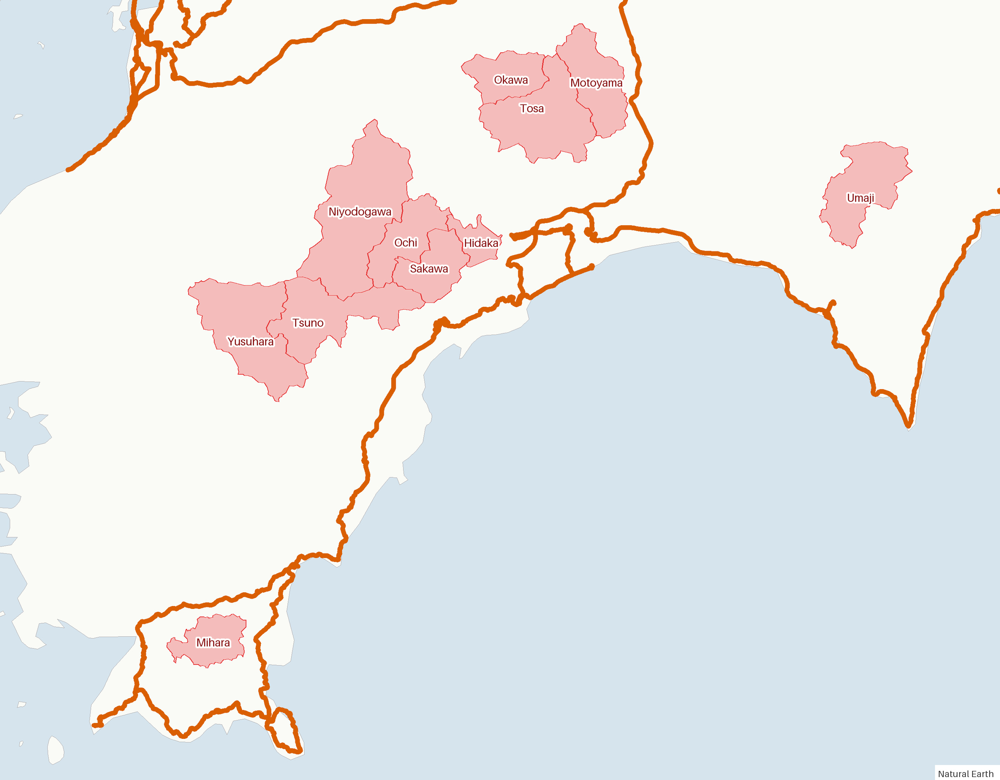
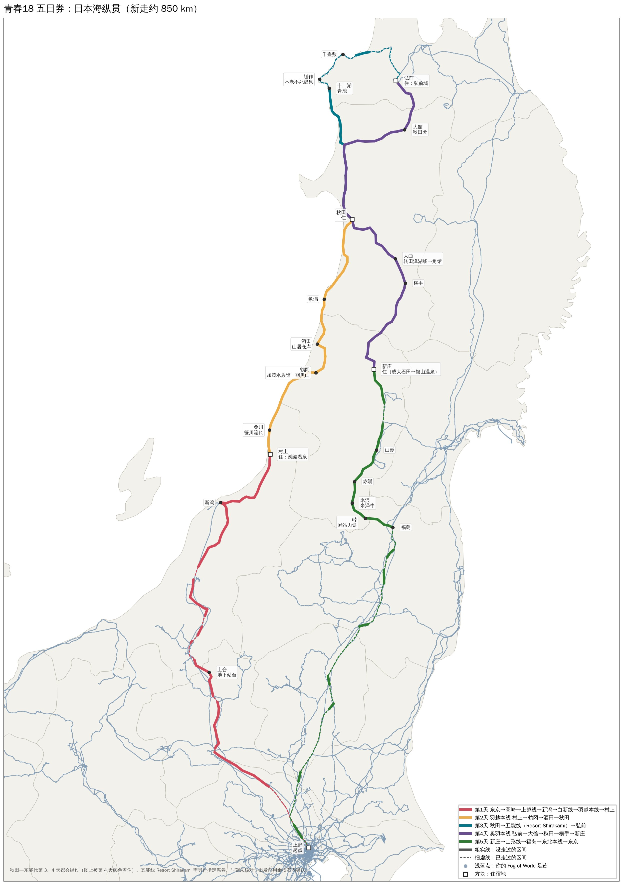
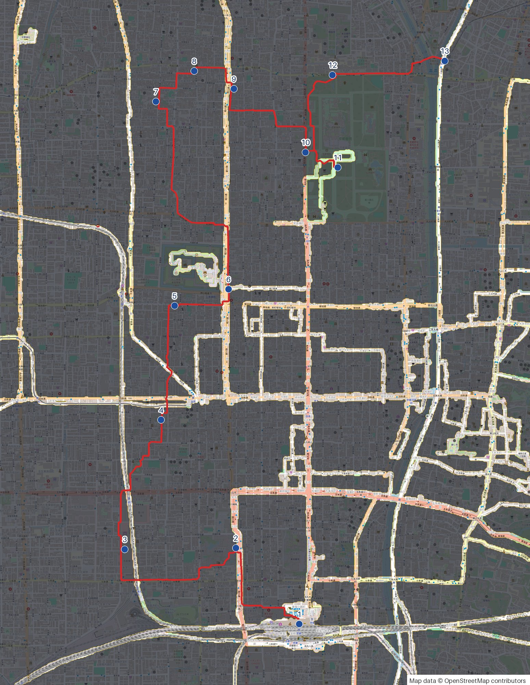
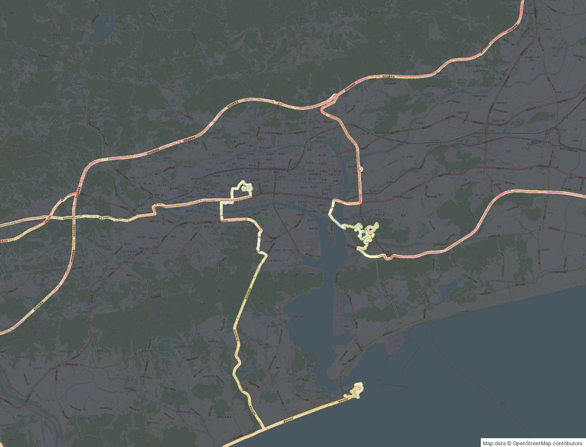
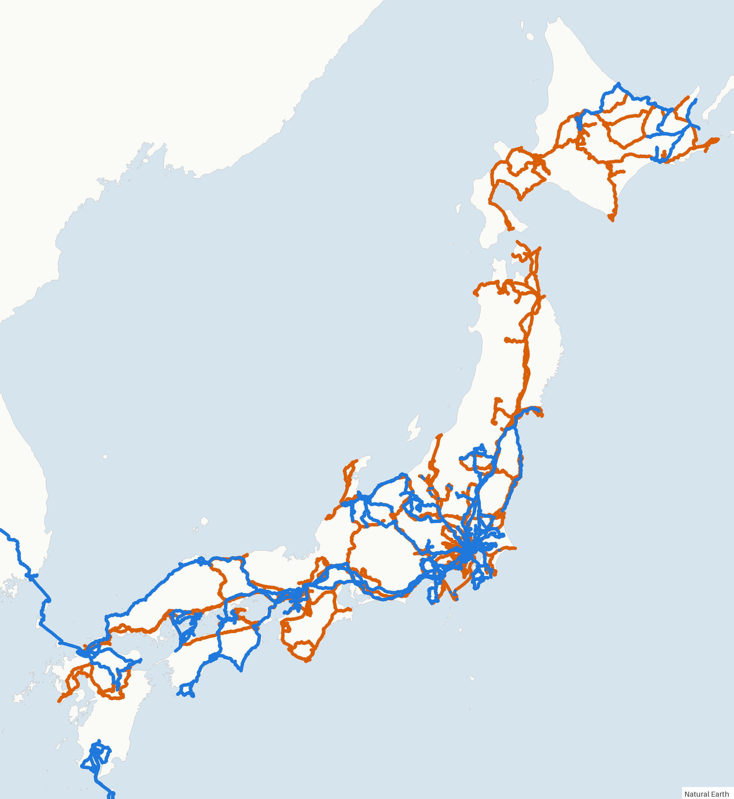
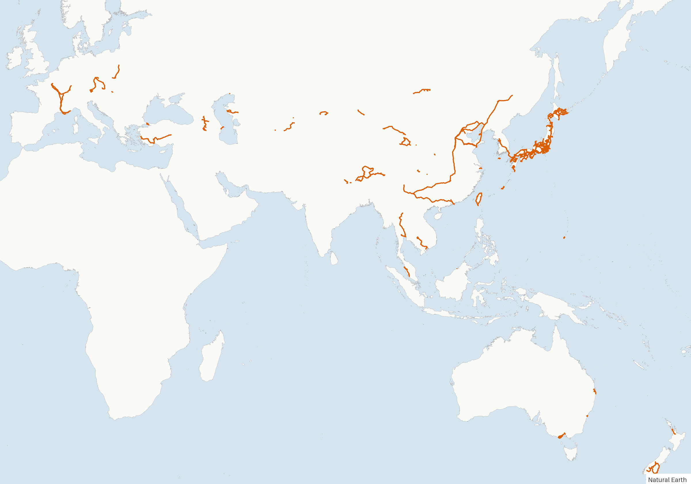

# Fogprint

[](../../LICENSE) [](../../SPONSOR.md)

[English](../../README.md) · [中文](../zh/README.md)

**フォグオブワールドの地図を AI に読ませる：どこへ行ったか、どこが残っているか、どう埋めるか。**

Fogprint は [フォグオブワールド（Fog of World）](https://fogofworld.app) の同期データを読み込み、Claude Code や Codex などの AI エージェントがそのまま使える形にします。コマンドラインツールと、その使い方をエージェントに教えるスキルのセットです。インストールしたら、あとは話しかけるだけです。

- 「アメリカでまだ行ったことのない州は？ 1 週間でできるだけ多く回る旅程を作って」
- 「九州の JR で乗っていない区間は？ 3 日間のフリーきっぷで長い区間から埋めたい」
- 「リヨンから 2 日間、走ったことのない道を中心にドライブしたい」
- 「住んでいる街で歩いたことのない地区は？ 10 km の散歩コースを提案して」
- 「高知旅行で地図に何が増えた？」「1 月と 8 月のスナップショットの差は？」
- 「日本の市区町村にいくつ行った？ 都道府県別に」
- 「スコットランドの足跡を地図にして」

世界中で使えます。国と州・県の境界は Natural Earth、各国の市区町村は geoBoundaries、道路・鉄道・街路は OpenStreetMap のデータを使います。

> Fogprint は独立したプロジェクトで、フォグオブワールドおよびその開発元とは関係ありません。データを読むだけで、アプリのフォルダには書き込みません。

## 例

Claude Code での実際の会話です。データは実在するフォグオブワールドのアカウント 1 つのものです。引用の先頭は Claude が自分で実行したコマンドで、あなたは質問するだけです。

### 「まだ行ったことのない都道府県は？ 最後のひとつに行く週末プランを作って」

> **Claude** · `fogprint regions --level admin1 --country JPN --unvisited-only --src all` を実行
>
> 47 都道府県のうち **46** に行っています。残りは **福井県** だけで、近づいたこともありません。いちばん近い足跡でも福井駅から 25 km、東尋坊から 13 km です。
>
> 2024 年 3 月に北陸新幹線が福井まで延びたので、東京から約 3 時間。週末で回れます。
>
> - **土曜**：新幹線で福井へ → 一乗谷朝倉氏遺跡 → 午後は永平寺 → あわら温泉泊。
> - **日曜**：午前に東尋坊 → 勝山の福井県立恐竜博物館 → 福井から東京へ。
>
> これで 47 都道府県制覇です。

### 「高知旅行で行けなかった市町村は？ 2 日間のドライブで回りたい」

> **Claude** · `fogprint regions --level ADM2 --country JPN --within Kochi --unvisited-only --geojson-out gaps.geojson` と `fogprint render --overlay gaps.geojson --basemap none` を実行
>
> 高知県 34 市町村のうち **23** に行っていて、ほとんどが海沿いです。行っていない 11 市町村（赤）は内陸の 3 か所に固まっています。
>
> <p align="center"></p>
>
> - **1 日目、仁淀川沿い**（7 市町村）：高知 → 日高村 → 佐川町 → 越知町 → 仁淀川町（安居渓谷）→ 津野町（四国カルストの天狗高原）→ 梼原町泊（隈研吾の木造建築群）。
> - **2 日目、嶺北**（3 町村）：山を越えて本山町、土佐町（早明浦ダム）、大川村（離島を除いて日本一人口の少ない村）→ 高知へ。
> - **三原村**（南西の奥）と **馬路村**（東のゆずの村）は遠回りになるので、次に足摺岬や室戸へ行くときに。

### 「青春 18 きっぷ 5 日間で東京発。乗ったことのない区間を一番多く稼げて、途中下車も楽しい JR 線は？」

> **Claude** · 駅の座標から JR 線の形を作り、JR 在来線すべてに `fogprint lines jr.geojson --tolerance-m 400` を実行してから周遊ルートを作成
>
> 東京周辺はほぼ乗り尽くしていて、空白は日本海側に集中しています。この周遊で **約 850 km が初乗り**になります。主な 6 路線は次のとおりです。
>
> | 路線 | 距離 | 未乗車 |
> |---|---|---|
> | 奥羽本線 弘前〜新庄 | 282 km | 280 km |
> | 羽越本線 新発田〜秋田 | 233 km | 233 km |
> | 山形線 福島〜新庄 | 140 km | 116 km |
> | 上越線 | 148 km | 68 km |
> | 五能線 | 135 km | 44 km |
> | 白新線 | 26 km | 25 km |
>
> - **1 日目**：東京 → 高崎 → 上越線（地下 70 m の土合駅）→ 新潟 → 白新線・羽越本線 → 村上、瀬波温泉泊。
> - **2 日目**：羽越本線で海沿いを北へ：桑川（笹川流れ）、鶴岡（加茂水族館、羽黒山）、酒田（山居倉庫）、象潟 → 秋田。
> - **3 日目**：リゾートしらかみで五能線：十二湖（青池）、艫作（不老ふ死温泉）、千畳敷 → 弘前。
> - **4 日目**：奥羽本線を南下：大館（秋田犬）、大曲（角館へ往復）、横手 → 新庄。
> - **5 日目**：山形線：山形、赤湯、米沢（米沢牛）、峠駅（ホームの力餅）→ 福島 → 東北本線 → 東京。
>
> リゾートしらかみはきっぷとは別に指定席券が必要です。五能線と上越線は本数が少ないので、出発前に乗換案内で毎日の列車を決めておいてください。
>
> <p align="center"></p>

### 「今週末は京都。歩いたことのない道を中心に散歩コースを作って」

> **Claude** · `fogprint around 35.0037,135.7595 --radius-km 3 --zoom 17` を実行し、大きな空白を OpenStreetMap の徒歩ルートでつないで、`fogprint lines walk.geojson` で確認、`fogprint render --overlay walk.geojson` で地図化
>
> 四条烏丸から半径 3 km の 250 m 四方のマスのうち、歩いたのは 60%。東と南はほぼ歩き尽くしていて（82%、80%）、北・西・南西はほとんど空白です（37%、46%、38%）。この **13.3 km（徒歩約 3 時間）のコースは 74% が初めて歩く道**です。
>
> 1 京都駅 → 2 西本願寺 → 3 島原 → 4 壬生寺 → 5 神泉苑 → 6 二条城 → 7–8 西陣 → 9 晴明神社 → 10 蛤御門 → 11 京都御所 → 12 今出川御門 → 13 出町柳（鴨川デルタ）。
>
> <p align="center"></p>

### 「高知旅行で地図に何が増えた？」

> **Claude** · `fogprint diff snapshot:2026-10 "Kochi 2026-11"` と `fogprint render --src all --around 33.56,133.55` を実行
>
> 今回の記録は 16.1 km²、そのうち **8.8 km² が新しいエリア**です。半分は高知県内（4.2 km²、初訪問）で、残りは移動中の分です。徳島、兵庫、愛知、静岡に新しい区間が増えました。
>
> <p align="center"></p>

### 「2024 年 1 月から地図はどれだけ広がった？」

> **Claude** · `fogprint diff snapshot:2024-01 snapshot:2026-10` と `fogprint render --basemap none --new-since snapshot:2024-01` を実行
>
> 386 km² から **656 km²** へ（+270 km²）、国・地域は 8 から **29** に増えました。海外で多いのはチベット（28 km²）、青海、カザフスタンのマンギスタウ州。国内では東京、鹿児島、千葉、北海道、富山です。青が増えた部分です。
>
> <p align="center"></p>

### 「行ったところを全部地図にして」

> **Claude** · `fogprint summary` と `fogprint render --basemap none --bbox=-12,-48,180,62` を実行
>
> 29 の国と地域、探索面積 653 km²。日本は 46/47 都道府県、中国は 22 の省級行政区、フランスは 26 県。
>
> <p align="center"></p>

JSON の出力例：[概要](../examples/summary.json)、[地域別](../examples/regions-admin1-JPN.json)、[スナップショットの差分](../examples/diff-snapshots.json)、[1 回の旅行を県別に](../examples/places-trip-database.json)。

## インストール

### Claude Code（プラグイン、おすすめ）

```bash
claude plugin marketplace add b-z/fogprint
claude plugin install fogprint@fogprint
```

初回使用時に、スキルが `fogprint` コマンドを（`uv`、`pipx`、`pip` のいずれかで）インストールします。あとはフォグオブワールドのデータについて話しかけてください。

### Codex などのエージェント

スキルのフォルダをエージェントのスキル用フォルダにコピーします。Codex の場合：

```bash
git clone https://github.com/b-z/fogprint.git
cp -r fogprint/skills/fogprint ~/.codex/skills/
```

スキルに対応していないエージェントには「[`skills/fogprint/SKILL.md`](../../skills/fogprint/SKILL.md) を読んで従って」と伝えてください。

### コマンドラインだけで使う

```bash
uv tool install git+https://github.com/b-z/fogprint   # または pipx install git+https://github.com/b-z/fogprint
fogprint locate
fogprint summary
```

Python 3.10 以上。依存パッケージ：numpy、shapely、pillow。

## データの場所

フォグオブワールドで同期（iCloud Drive または Dropbox）をオンにしてください。Fogprint は次の場所を探します。

- macOS：`~/Library/Mobile Documents/iCloud~com~ollix~FogOfWorld/Documents`
- Windows（iCloud for Windows）：`~/iCloudDrive/iCloud~com~ollix~FogOfWorld`
- Dropbox：`~/Dropbox/Apps/Fog of World` など

このフォルダの中の、現在の `Sync` フォルダ、`Databases/*.fwdb` にある別のデータベース（旅行ごとに作る人も多い）、`Databases/Primary.fwdb/Snapshots` にある日付付きスナップショット、`Sync*.zip` のバックアップを読みます。ほかの場所にある場合は `fogprint --src <フォルダまたは zip>` で指定するか、環境変数 `FOGPRINT_DATA` を設定してください。

## コマンド

すべてのコマンドは JSON を出力します。地点は `緯度,経度`（Google マップでコピーされる順）、範囲は `--bbox 西,南,東,北` で指定します（最初の数が負のときは `--bbox=-10,...`）。

| コマンド | 内容 |
|---|---|
| `locate` | このマシンで見つかったデータの一覧 |
| `summary` | 探索面積、範囲、訪れた国と第 1 級行政区 |
| `regions` | 国、州・県（`admin1`）、市区町村（`--level ADM2 --country JPN`）、任意の GeoJSON ポリゴンごとの探索面積。`--unvisited-only` で未訪問だけ、`--within Kochi` で 1 つの県内に限定、`--geojson-out` で地図用に出力 |
| `places` | 州・省・都道府県ごとにまとめた訪問先 |
| `check` | 地点が探索済みか、最寄りの探索済み地点までの距離 |
| `around` | 地点の周囲の方角別カバー率と、陸上の大きな未探索エリア |
| `osm` | OpenStreetMap から鉄道、道路、街路、自転車道、ハイキングルート、フェリー航路を取得 |
| `lines` | GeoJSON / GPX / KML の各ラインの探索済み割合と、未探索の区間 |
| `diff` | 2 つのスナップショットやデータベースの間に増えたエリアを地域別に |
| `export` | 探索エリアを GeoJSON ポリゴンまたは CSV のグリッドで出力 |
| `render` | PNG 地図：OpenStreetMap に霧を重ねる、またはシンプルな陸地図に足跡、ルートの重ね描きも可 |

`--src` でデータを選びます：パス、データベース名、`snapshot:2024-08`、または `all`（全データベースを統合）。`--lang en|zh|ja` で地名の言語を設定します。

Python から：

```python
from fogprint import FogMap, locate, pick_default

fog = FogMap.load(pick_default(locate(), "main"))
print(fog.area_km2())
x, y, pixels, lng, lat, km2 = fog.grid_lnglat(14)   # ズーム 14 の探索済みセル
```

## データでわかること、わからないこと

- フォグオブワールドが保存しているのは、世界を Web Mercator 図法で 2²² × 2²² ピクセル（1 ピクセル約 9.5 m × cos(緯度)）に分けたビットマップで、どのピクセルが晴れたかだけです。**時刻の情報はない**ので、「いつ」はスナップショットの比較でしかわかりません。
- 面積・世界に占める割合・レベルは Fog of World アプリ自身の計算方法に合わせています（「迷雾资料库」の解析記事による）。晴れたピクセル 1 つが (9.5546 m × cos 緯度)²、地球の表面積 510,072,000 km²、レベル = ⌊√(250 × km²)⌋。国はグリッド単位で割り当てるため、国境付近ではアプリのパスポートの値と少しずれることがあります。
- 「探索面積」は晴れた面積そのものです。車で走っても数十 m 幅の帯が晴れるだけなので、国中を回っても割合はごくわずかになることがあります。
- GPS をオンにしたまま飛行機や新幹線で通過した地域も訪問済みになります。実際にどれだけ晴れたかは `cells` と `explored_km2` で確認できます。

ファイル形式は [`src/fogprint/fogformat.py`](../../src/fogprint/fogformat.py) に書いてあります。

## プライバシー

処理はすべて手元のコンピューターで行います。Fogprint は境界データ、OpenStreetMap のライン、地図タイルをダウンロードしますが、あなたのデータをどこかへ送ることはありません。エージェントは、ほかのファイルを開かせたときと同じように、読み込んだ結果を見ます。足跡の地図からは住んでいる場所やよく行く場所がわかるので、共有するときは注意してください。

## データの出典

- 国・第 1 級行政区の境界、陸地：[Natural Earth](https://www.naturalearthdata.com)（パブリックドメイン）。
- 市区町村の境界：[geoBoundaries](https://www.geoboundaries.org)（国ごとにライセンスが異なり、多くは CC BY 4.0 / ODbL。出力に記載されます）。
- 鉄道、道路、街路、背景地図タイル：© [OpenStreetMap](https://www.openstreetmap.org/copyright) 貢献者（ODbL）。Overpass API と tile.openstreetmap.org から取得します。[利用ポリシー](https://operations.osmfoundation.org/policies/)を守ってください。

## 関連プロジェクト

[Fog Trace](https://github.com/b-z/fog-trace)（[ブラウザで開く](https://b-z.github.io/fog-trace/)）は同じ作者による Web ツールで、データそのものを修正するためのものです。軌跡が途切れている場所を自動で見つけて 1 つずつ確認し、GPS の飛びを消したり足りない道を描き足したりして、アプリに取り込める形で書き出せます。Fogprint は読み込みと分析だけを行います。データを編集したいときは Fog Trace を使ってください。

## プロジェクトを支援する

Fogprint は空き時間に保守しています。地図を晴らすのに役立ったら、[GitHub Sponsors](https://github.com/sponsors/b-z) や WeChat で支援していただけるとうれしいです。支援は任意で、Issue やプルリクエストの扱いには影響しません。

<table><tr>
<td align="center" valign="middle"><a href="https://github.com/sponsors/b-z"></a></td>
<td align="center" valign="middle"></td>
</tr></table>

## ライセンス

[MIT](../../LICENSE)。
