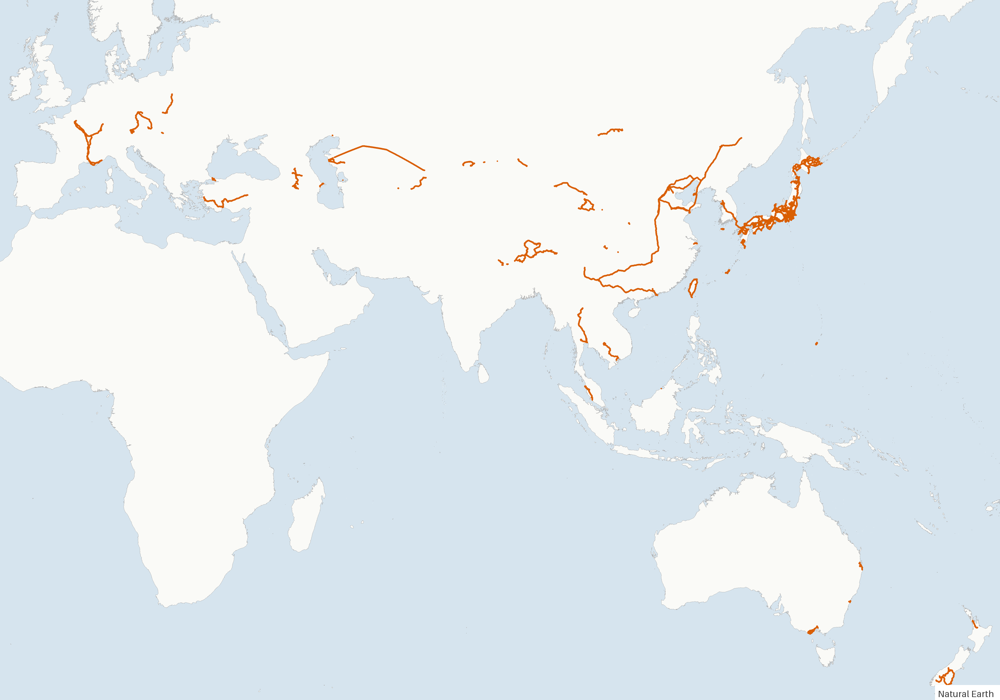
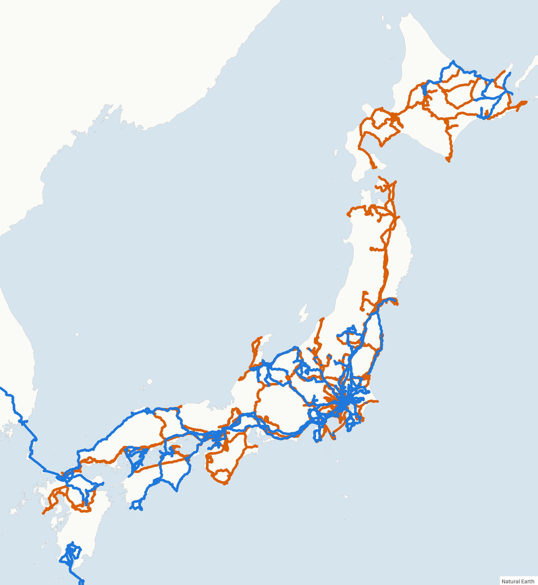
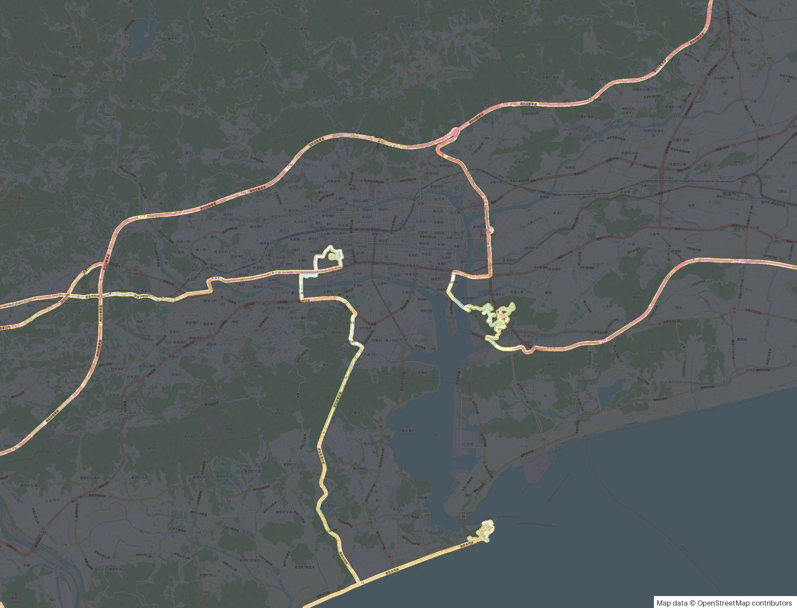

# fogprint

[](../../LICENSE) [](https://github.com/sponsors/b-z)

[English](../../README.md) · [日本語](../ja/README.md)

**让 AI 读懂你的《世界迷雾》地图：去过哪里、还差哪里、怎么去补。**

fogprint 读取 [世界迷雾（Fog of World）](https://fogofworld.app) 的同步数据，整理成 Claude Code、Codex 这类 AI 工具能直接用的结果。它由一个命令行工具和一个 skill 组成：命令行负责解析和计算，skill 告诉 AI 怎么用。装好之后直接提问就行：

- “美国哪些州我还没去过？排一个一周的行程，尽量多去几个。”
- “九州的 JR 线路里哪些我还没坐过？用 3 天的周游券把最长的几段补上。”
- “从里昂出发，开两天车，尽量走我没走过的路。”
- “我住的城市里哪些街区还没走过？帮我规划一条 10 公里的散步路线。”
- “这次高知之行在地图上新增了哪些地方？”“一月和八月的快照之间多了什么？”
- “日本的市町村我去过多少个？按都道府县列出来。”
- “把我在苏格兰的足迹画成地图。”

全球通用：国家和一级行政区边界来自 Natural Earth，任意国家的市县区来自 geoBoundaries，道路、铁路、街道来自 OpenStreetMap。

> fogprint 是独立项目，与世界迷雾及其开发者无关。它只读取你的数据，不会写入 App 的文件夹。

## 示例

以下都来自同一个真实的世界迷雾账号。

<p align="center"></p>
<p align="center"><code>fogprint render --src all --basemap none --bbox=-12,-48,180,62</code></p>

| 日本：蓝色是 2024 年 1 月快照之后新增的 | 一次旅行，OpenStreetMap 底图加迷雾 |
|---|---|
|  |  |
| `fogprint render --src all --basemap none --new-since snapshot:2024-01 --bbox 128.3,30.6,146.2,45.8` | `fogprint render --src all --bbox 133.44,33.48,133.66,33.62` |

AI 读到的数据长这样（`fogprint regions --level admin1 --country JPN --unvisited-only`，有删减）：

```json
{
 "boundaries": "Natural Earth (public domain)",
 "regions_total": 47,
 "regions_visited": 46,
 "regions": [
  {"name": "Fukui Prefecture", "id": "JP-18", "visited": false, "explored_km2": 0.0,
   "region_km2": 4220.2, "center": [136.42952, 35.80352]}
 ]
}
```

更多输出样例：[总览](../examples/summary.json)、[按地区统计](../examples/regions-admin1-JPN.json)、[快照对比](../examples/diff-snapshots.json)、[一次旅行按县汇总](../examples/places-trip-database.json)。

## 安装

### Claude Code（插件，推荐）

```bash
claude plugin marketplace add b-z/fogprint
claude plugin install fogprint@fogprint
```

第一次用时，skill 会自动安装 `fogprint` 命令（用 `uv`、`pipx` 或 `pip`）。之后直接聊你的世界迷雾数据即可。

### Codex 和其他 AI 工具

把 skill 文件夹复制到工具的 skills 目录，以 Codex 为例：

```bash
git clone https://github.com/b-z/fogprint.git
cp -r fogprint/skills/fogprint ~/.codex/skills/
```

不支持 skill 的工具，可以让它“读 [`skills/fogprint/SKILL.md`](../../skills/fogprint/SKILL.md) 并照做”。

### 只用命令行

```bash
uv tool install git+https://github.com/b-z/fogprint   # 或 pipx install git+https://github.com/b-z/fogprint
fogprint locate
fogprint summary
```

需要 Python 3.10 以上。依赖：numpy、shapely、pillow。

## 数据在哪里

在世界迷雾里打开同步（iCloud Drive 或 Dropbox）。fogprint 会在这些位置查找：

- macOS：`~/Library/Mobile Documents/iCloud~com~ollix~FogOfWorld/Documents`
- Windows（iCloud for Windows）：`~/iCloudDrive/iCloud~com~ollix~FogOfWorld`
- Dropbox：`~/Dropbox/Apps/Fog of World` 等

在这个文件夹里，它会读取当前的 `Sync` 文件夹、`Databases/*.fwdb` 里的其他数据库（很多人一次旅行建一个）、`Databases/Primary.fwdb/Snapshots` 里带日期的快照，以及 `Sync*.zip` 备份。数据在别处时，用 `fogprint --src <文件夹或 zip>` 指定，或设置环境变量 `FOGPRINT_DATA`。

## 命令

所有命令都输出 JSON。点的写法是 `纬度,经度`（和从 Google 地图复制出来的顺序一样）；范围写成 `--bbox 西,南,东,北`（第一个数是负数时写成 `--bbox=-10,...`）。

| 命令 | 作用 |
|---|---|
| `locate` | 列出本机找到的数据 |
| `summary` | 探索面积、范围、去过的国家和一级行政区 |
| `regions` | 按国家、州省（`admin1`）、市县区（`--level ADM2 --country CHN`）或任意 GeoJSON 多边形统计探索面积；`--unvisited-only` 只列没去过的 |
| `places` | 按州、省、都道府县汇总去过的地方 |
| `check` | 某个点是否探索过，离最近的已探索位置多远 |
| `around` | 某点周围各方向的覆盖率，以及陆地上最大的几块空白 |
| `osm` | 从 OpenStreetMap 下载铁路、道路、街道、自行车道、徒步路线或轮渡航线 |
| `lines` | GeoJSON / GPX / KML 里每条线走过的比例，以及没走过的路段 |
| `diff` | 两个快照或数据库之间新增的区域，按地区列出 |
| `export` | 把探索区域导出为 GeoJSON 多边形或 CSV 格点 |
| `render` | 出 PNG 地图：OpenStreetMap 底图加迷雾，或简单陆地底图加足迹，可叠加路线 |

`--src` 选择数据：路径、数据库名、`snapshot:2024-08`，或 `all`（合并所有数据库）。`--lang en|zh|ja` 设置地名语言。

在 Python 里使用：

```python
from fogprint import FogMap, locate, pick_default

fog = FogMap.load(pick_default(locate(), "main"))
print(fog.area_km2())
x, y, pixels, lng, lat, km2 = fog.grid_lnglat(14)   # zoom 14 下的已探索格子
```

## 数据能说明什么，不能说明什么

- 世界迷雾存的是一张位图：把全球按 Web Mercator 投影铺成 2²² × 2²² 个像素，每个像素约 9.5 米 × cos(纬度)，记录哪些像素被点亮。**没有时间信息**，所以“什么时候去的”只能靠对比快照来回答。
- “探索面积”就是点亮的面积本身。开车只会点亮几十米宽的一条带子，所以走遍一个国家，面积占比也可能很小。
- 开着 GPS 坐飞机或高铁经过的地区也会算作去过。`cells` 和 `explored_km2` 能看出实际点亮了多少。

存档格式写在 [`src/fogprint/fogformat.py`](../../src/fogprint/fogformat.py) 里。

## 隐私

所有计算都在你自己的电脑上进行。fogprint 会下载边界数据、OpenStreetMap 线路和地图瓦片，但不会把你的数据发到任何地方。AI 工具能看到它读取的结果，和你让它打开其他文件一样。足迹地图能看出你住在哪里、常去哪里，分享前请留意。

## 数据来源

- 国家、一级行政区边界和陆地：[Natural Earth](https://www.naturalearthdata.com)（公有领域）。
- 市县区边界：[geoBoundaries](https://www.geoboundaries.org)（各国许可不同，多为 CC BY 4.0 / ODbL，输出里会写明）。
- 铁路、道路、街道和底图瓦片：© [OpenStreetMap](https://www.openstreetmap.org/copyright) 贡献者（ODbL），通过 Overpass API 和 tile.openstreetmap.org 获取。请遵守它们的[使用政策](https://operations.osmfoundation.org/policies/)。

## 支持这个项目

fogprint 是在业余时间维护的。如果它帮你点亮了更多地图，欢迎通过 [GitHub Sponsors](https://github.com/sponsors/b-z) 或微信赞赏支持。赞助完全自愿，不会影响 Issue 和 Pull Request 的处理。

<table><tr>
<td align="center" valign="middle"><a href="https://github.com/sponsors/b-z"></a></td>
<td align="center" valign="middle"></td>
</tr></table>

## 许可证

[MIT](../../LICENSE)。
